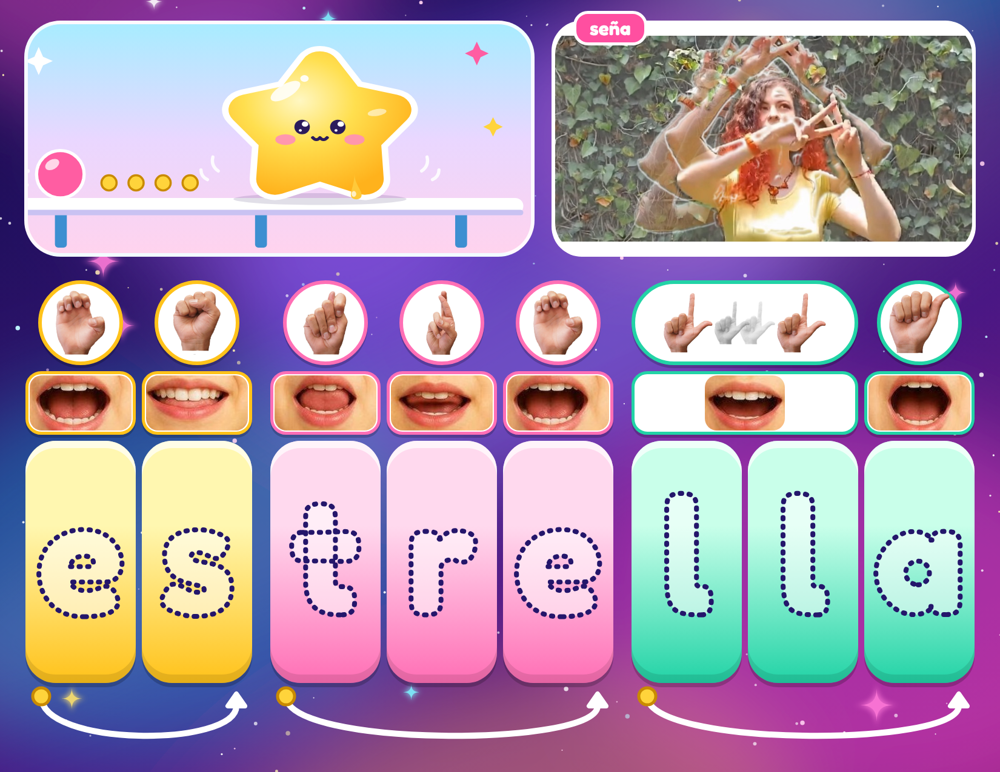

# Tarjetas de Valeria

Tarjetas para que Valeria aprenda a reconocer letras, sílabas y palabras escritas (con la seña LSM como apoyo), diseñadas según los gustos de Valeria
(juegos de pelota y monedas, slime, ramen y comida coreana, carritos veloces pero tiernos, cocinar, nadar, hoteles).

📚 **Todas las tarjetas juntas en un solo PDF:** [tarjetas/TODAS-LAS-TARJETAS.pdf](tarjetas/TODAS-LAS-TARJETAS.pdf)

| Palabra | Tarjeta |
|---|---|
| estrella | [PDF A4](tarjetas/estrella.pdf) · [vista previa](tarjetas/estrella-frente.png) |
| taco | [PDF A4](tarjetas/taco.pdf) · [vista previa](tarjetas/taco-frente.png) |

## Diseño base

La tarjeta de "estrella" es el diseño base aprobado (commit `41fe6a8`). Todas las tarjetas nuevas siguen este formato: una hoja A4 con escena, mano LSM, boca y letra por columna, arcos por sílaba y la seña de la palabra.

## Pedir una tarjeta nueva

Abre una sesión de Claude Code con este repositorio y escribe, por ejemplo:

> Hazme la tarjeta de **ramen**. (Adjunta el dibujo o la tarjeta con la seña, si la tienes.)

Claude sigue las reglas de `CLAUDE.md`. Manda de preferencia un video corto de la seña (de frente, fondo liso). Resultado: `tarjetas/<palabra>.pdf`, listo para imprimir en A4. Para generar una tarjeta a mano: `node generar.js tarjetas/<palabra>.json`
(necesita Node y Playwright).
